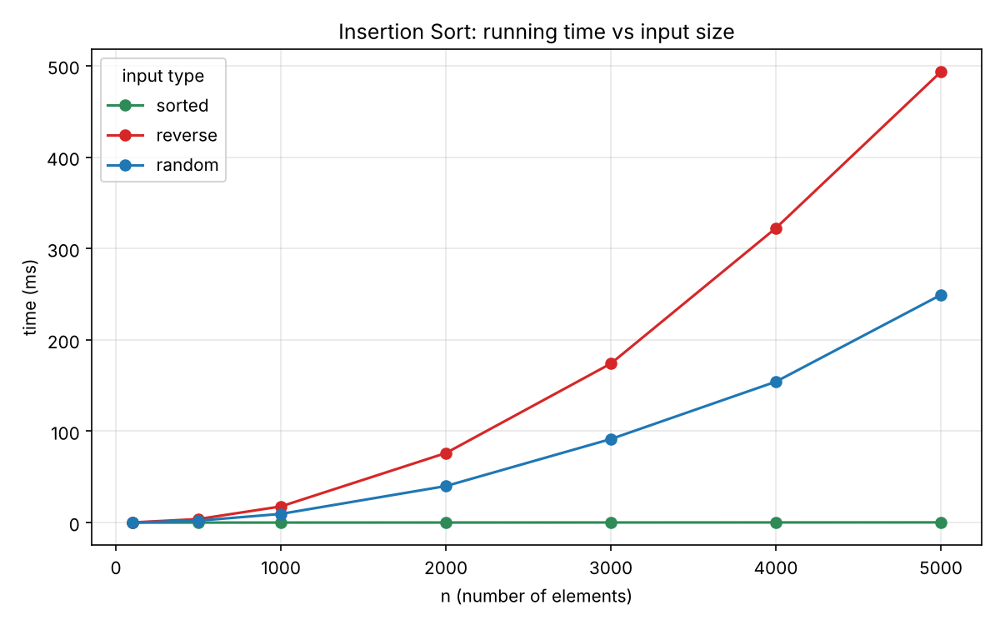
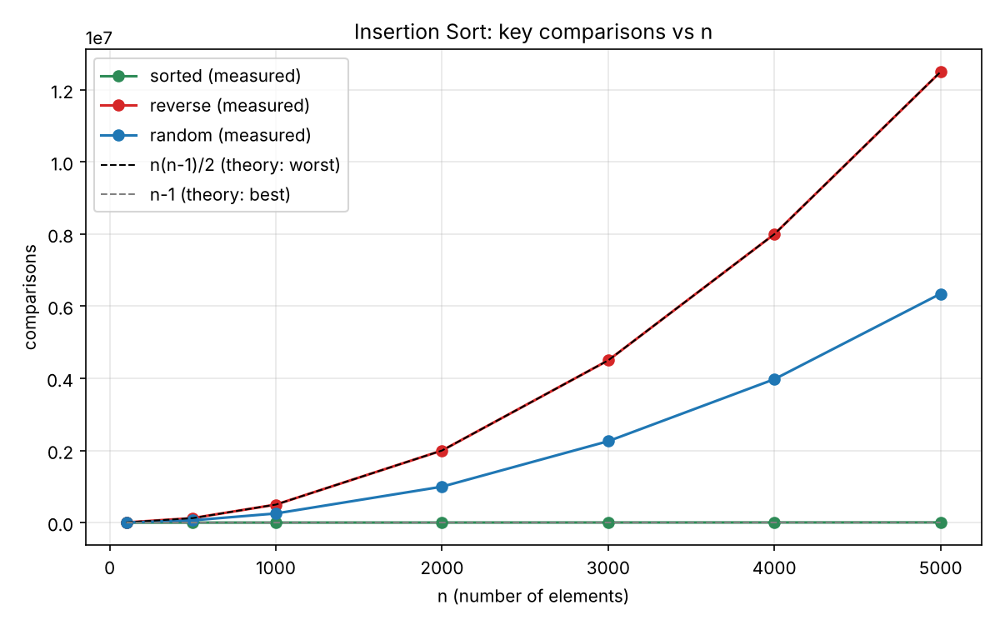
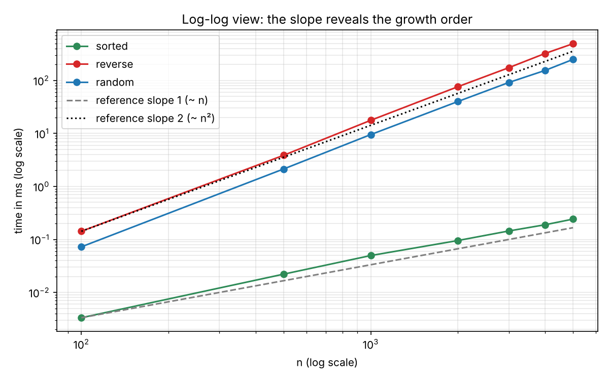
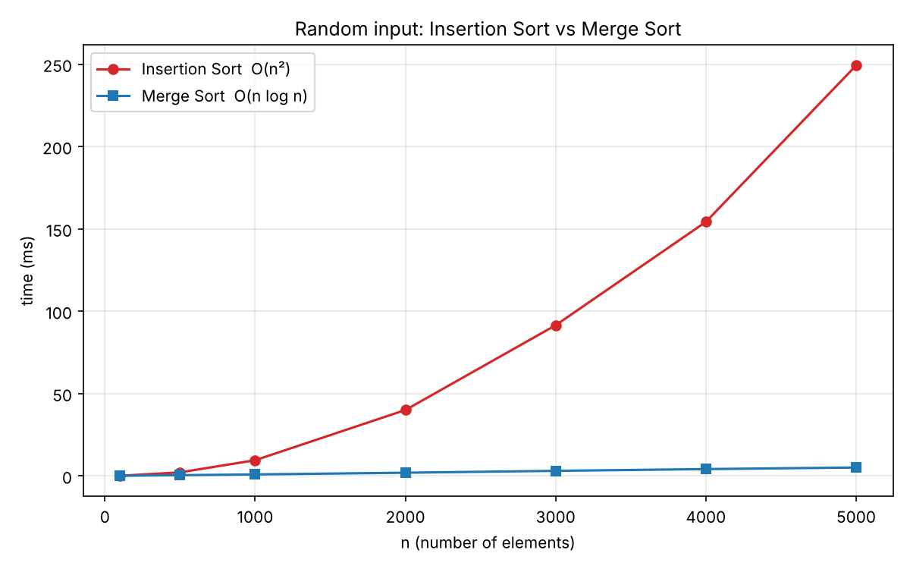

# Empirical Analysis of Insertion Sort

**Course:** CS314 – Analysis of Algorithms  |  **Topic:** Lecture 1 – Mini Project
**Language:** Python 3  |  **Libraries:** `matplotlib` (plots only)

This project is an *empirical* study of **Insertion Sort**: I implemented the algorithm exactly as in the
lecture, counted its **comparisons** and **shifts**, measured its **running time** on sorted, reverse-sorted
and random inputs (n = 100 … 5,000), plotted the results, and compared the curves with the theoretical
bounds **O(n)** and **O(n²)**. Finally, I compared it with **Merge Sort** (O(n log n)).

---

## 1. Project structure

```
insertion-sort-analysis/
├── src/
│   ├── sorting.py        # Insertion Sort + Merge Sort (plain and counted versions)
│   └── experiment.py     # runs all experiments, saves CSV + plots
├── tests/
│   └── test_sorting.py   # unit tests (incl. examples from the lecture)
├── results/
│   ├── results.csv       # raw measurements
│   ├── run_log.txt       # console output of the run
│   └── *.png             # plots used in this report
├── requirements.txt
└── README.md             # this report
```

## 2. How to run

```bash
pip install -r requirements.txt
python -m unittest discover -s tests -v     # run the tests
python src/experiment.py                    # full experiment (about 1 minute)
python src/experiment.py --quick            # fast version (n up to 1,000)
```

The experiment overwrites everything in `results/`. Exact times depend on the machine, but the
growth *shape* (linear vs. quadratic) is the same everywhere.

## 3. Implementation

The code follows the lecture's pseudocode (0-indexed):

```python
def insertion_sort(arr):
    for i in range(1, len(arr)):
        key = arr[i]
        j = i - 1
        while j >= 0 and arr[j] > key:
            arr[j + 1] = arr[j]     # shift larger element to the right
            j -= 1
        arr[j + 1] = key            # insert the key in its place
    return arr
```

* **Comparisons** = number of times `arr[j] > key` is evaluated.
* **Shifts** = number of times an element is moved one position to the right.
* Two versions exist on purpose: a *plain* one for **timing** (no counter overhead) and a
  *counted* one for **counting**. Every run is checked against Python's built-in `sorted()`.
* **Correctness evidence:** the unit tests reproduce the lecture's worked example
  `[7, 3, 9, 2, 5]` → **8 comparisons, 6 shifts**, and the answer-key values for `[4, 3, 2, 1]`
  (6 comparisons, 6 shifts) and `[1, 2, 3, 4]` (3 comparisons, 0 shifts).

## 4. Experiment design

| Item | Setting |
|---|---|
| Input sizes | n = 100, 500, 1000, 2000, 3000, 4000, 5000 |
| Input types | **Sorted** (best case), **Reverse-sorted** (worst case), **Random** (average case) |
| Timing | `time.perf_counter()`, average of **5 runs** per point |
| Random data | shuffled permutation of 1..n, fixed seed (`42`) for reproducibility |

## 5. Results

### 5.1 Running time of Insertion Sort

| n | Sorted (ms) | Reverse (ms) | Random (ms) |
|---:|---:|---:|---:|
| 100 | 0.003 | 0.14 | 0.07 |
| 500 | 0.022 | 3.87 | 2.14 |
| 1,000 | 0.050 | 17.70 | 9.52 |
| 2,000 | 0.095 | 76.12 | 40.00 |
| 3,000 | 0.144 | 174.06 | 91.46 |
| 4,000 | 0.189 | 322.33 | 154.23 |
| 5,000 | 0.242 | 493.35 | 249.22 |



Sorted input stays almost flat on this scale, while reverse and random inputs curve upward sharply.

### 5.2 Counting comparisons and shifts

| n | Sorted comps | Sorted shifts | Reverse comps = shifts | Theory n(n-1)/2 | Random comps | Random shifts |
|---:|---:|---:|---:|---:|---:|---:|
| 100 | 99 | 0 | 4,950 | 4,950 | 2,597 | 2,502 |
| 500 | 499 | 0 | 124,750 | 124,750 | 63,562 | 63,073 |
| 1,000 | 999 | 0 | 499,500 | 499,500 | 253,213 | 252,225 |
| 2,000 | 1,999 | 0 | 1,999,000 | 1,999,000 | 996,394 | 994,396 |
| 3,000 | 2,999 | 0 | 4,498,500 | 4,498,500 | 2,257,558 | 2,254,566 |
| 4,000 | 3,999 | 0 | 7,998,000 | 7,998,000 | 3,976,295 | 3,972,301 |
| 5,000 | 4,999 | 0 | 12,497,500 | 12,497,500 | 6,345,469 | 6,340,474 |



The measured counts match the theory **exactly**:

* **Sorted (best case):** `n − 1` comparisons and **0 shifts**.
* **Reverse (worst case):** `n(n − 1)/2` comparisons and shifts (e.g. n = 5000 → 12,497,500).
* **Random (average case):** about **half** of the worst case (≈ n²/4), as expected.

### 5.3 Log-log plot: finding the growth order



On a log-log plot a function `n^k` is a straight line with slope `k`. The fitted slopes
(from n = 100 to n = 5000) are:

| Input | Measured slope | Matches |
|---|---:|---|
| Sorted | ≈ 1.1 (≈ 1.0 for n ≥ 1000) | **O(n)** (linear) |
| Reverse | ≈ 2.1 | **O(n²)** (quadratic) |
| Random | ≈ 2.1 | **O(n²)** (quadratic) |

The slightly higher slope for small sizes comes from fixed overheads (loop setup, timer resolution).

## 6. Analysis

| Case | Input | Complexity | Evidence |
|---|---|---|---|
| Best | already sorted | Ω(n) | n − 1 comparisons, 0 shifts, slope ≈ 1 |
| Worst | reverse sorted | O(n²) | n(n−1)/2 shifts, slope ≈ 2 |
| Average | random | Θ(n²) | ≈ half the worst case, slope ≈ 2 |

**Why the number of shifts drives the cost.** The `while` loop (lines 5–7 of the pseudocode) runs once per
shift, so the total running time is dominated by the shifts. A sorted input never enters the loop,
so each pass costs O(1) and the total is linear. In a reversed input every key moves past the whole sorted
part, giving 1 + 2 + … + (n−1) = n(n−1)/2 shifts.

**Scaling check (from the lecture's numerical problem).** For the reverse input, going from
n = 1,000 to n = 5,000 (5x bigger) increased the time by roughly 25–30x, which agrees with the
quadratic prediction (5² = 25).

**Space.** Insertion sort sorts in place and needs only O(1) extra memory. It is time-costly for
large random data but space-cheap, which illustrates the time–space trade-off from the lecture.

## 7. Comparison with Merge Sort

Merge Sort uses *divide and conquer* (split into halves, then merge the sorted halves), giving
**O(n log n)** in all cases.

| n | Insertion Sort (ms) | Merge Sort (ms) | Speed-up of Merge Sort |
|---:|---:|---:|---:|
| 100 | 0.07 | 0.06 | 1.1x |
| 500 | 2.14 | 0.43 | 5.0x |
| 1,000 | 9.52 | 0.88 | 10.8x |
| 2,000 | 40.00 | 1.93 | 20.8x |
| 3,000 | 91.46 | 3.06 | 29.9x |
| 4,000 | 154.23 | 4.13 | 37.3x |
| 5,000 | 249.22 | 5.08 | 49.1x |



* For very small inputs (n ≈ 100) the two are close, because Merge Sort's recursion and list
  copying add overhead.
* As n grows, Insertion Sort's quadratic growth makes it fall far behind: at n = 5,000 Merge Sort is
  about **49x faster** on random data.
* Merge Sort's time is practically the same for sorted, reverse and random input, while Insertion Sort
  varies by a factor of about 2,000 between its best and worst case at n = 5,000 (see `results.csv`).
* Merge Sort needs **O(n) extra memory**, whereas Insertion Sort needs O(1): the time–space trade-off again.

## 8. Conclusions

1. The experiments confirm the theory: Insertion Sort is **Ω(n)** in the best case and **O(n²)** in the
   worst and average cases.
2. The number of **shifts** (not just comparisons) explains why reverse input is the worst case.
3. Insertion Sort is a good choice for **small or nearly sorted** inputs, and is simple and in-place;
   for **large random** inputs, an O(n log n) algorithm such as Merge Sort is far better.
4. Counting operations gives exact, machine-independent evidence, while timing shows real-world
   behaviour; using both makes the analysis more reliable.

## 9. Limitations

* Timings are in pure Python and depend on the machine and background load; the *trends* are what matter.
* The largest size is n = 5,000 (as in the project statement); larger sizes would show the gap even more clearly.
* Only integer data without duplicates was used in the timing experiments (duplicates are covered in the unit tests).

## 10. Reference

* Lecture 1 – *Algorithms: Analysis and Design*, CS314 Analysis of Algorithms (2026): Insertion Sort,
  running-time analysis, and Mini Project description.
