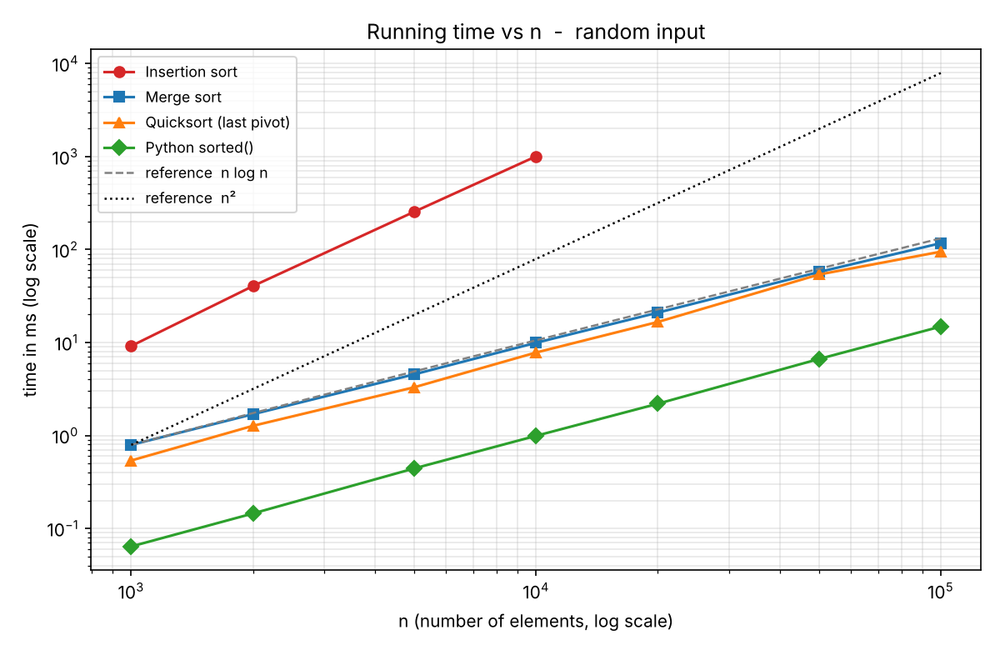

# Sorting Benchmark Lab

**CS314 – Analysis of Algorithms · Lecture 2 (Divide and Conquer) · Mini project: *Sorting Benchmark Lab* (Beginner)**
**Author:** [Your Name] · **ID:** [Your ID]

Compares **insertion sort**, **merge sort**, **quicksort** (last-element pivot) and Python **`sorted()`** on
**sorted**, **reversed** and **random** data for n = 1,000 … 100,000, and checks the measured growth against
n log n and n². Bonus: quicksort with a random pivot.

📄 **Full report: [REPORT.md](REPORT.md)** · 🎬 **Demo script: [docs/DEMO_SCRIPT.md](docs/DEMO_SCRIPT.md)** ·
💭 **Reflection: [docs/REFLECTION.md](docs/REFLECTION.md)**

## Highlights

* Insertion sort on random data is about **100x slower** than merge sort at n = 10,000 (quadratic vs n log n).
* Quicksort with a last-element pivot is about **300x slower on sorted input** than on random input at n = 10,000;
  a random pivot fixes it.
* Python's `sorted()` is about **8x faster** than my merge sort and nearly instant on sorted data.



## Project structure

```
sorting-benchmark-lab/
├── src/
│   ├── sorting_algorithms.py   # insertion, merge, quick (last / random pivot), sorted()
│   ├── datasets.py             # sorted / reversed / random input generators
│   ├── benchmark.py            # runs the experiments, saves CSVs and plots
│   └── demo.py                 # step-by-step merge sort + PARTITION trace (for the demo)
├── tests/test_sorting.py       # 10 unit tests
├── results/                    # CSVs, run log and PNG figures used in the report
├── docs/DEMO_SCRIPT.md         # 5-minute walkthrough script
├── docs/REFLECTION.md          # reflection
├── REPORT.md                   # report
├── requirements.txt
└── README.md
```

## How to run

Requires Python 3.8+.

```bash
pip install -r requirements.txt

python -m unittest discover -s tests -v   # run the unit tests
python src/demo.py                        # step-by-step trace for the demo
python src/benchmark.py --quick           # fast sanity run (about 10 s)
python src/benchmark.py                   # full run (about 2 minutes), writes results/
```

Option: `--quad-cap N` changes the largest n used for the quadratic combinations (default 10,000).

> **Why a cap?** Insertion sort (reversed/random) and last-pivot quicksort (sorted/reversed) need about n²/2 steps;
> at n = 100,000 that is hours in pure Python. They run up to n = 10,000; everything else runs to n = 100,000.

## Results at a glance (milliseconds, median of up to 5 runs)

**n = 10,000**

| Algorithm | Sorted | Reversed | Random |
|---|---:|---:|---:|
| Insertion sort | 0.50 | 2,114.3 | 1,004.8 |
| Merge sort | 7.91 | 7.65 | 9.93 |
| Quicksort (last pivot) | 2,338.2 | 1,600.2 | 7.80 |
| Quicksort (random pivot) *bonus* | 9.45 | 9.27 | 9.92 |
| Python `sorted()` | 0.03 | 0.04 | 0.99 |

**n = 100,000**

| Algorithm | Sorted | Reversed | Random |
|---|---:|---:|---:|
| Insertion sort | 5.34 | n/a (capped) | n/a (capped) |
| Merge sort | 94.4 | 91.2 | 117.0 |
| Quicksort (last pivot) | n/a (capped) | n/a (capped) | 94.8 |
| Quicksort (random pivot) *bonus* | 103.9 | 106.3 | 123.6 |
| Python `sorted()` | 0.58 | 1.17 | 14.8 |

All raw measurements: [`results/benchmark_results.csv`](results/benchmark_results.csv). Fitted growth exponents:
[`results/growth_rates.csv`](results/growth_rates.csv). Absolute times depend on the machine; the growth trends do not.

## Hand-in checklist (Lecture 2, "What to hand in")

| Item | Where |
|---|---|
| Code: clean repository, README, unit tests | `src/`, `tests/`, this README |
| Report: problem, method, complexity analysis, experiments, conclusion | [REPORT.md](REPORT.md) |
| Demo: 5-minute walkthrough | [docs/DEMO_SCRIPT.md](docs/DEMO_SCRIPT.md) (+ `python src/demo.py`) |
| Reflection | [docs/REFLECTION.md](docs/REFLECTION.md) |

## References

* Lecture 2 – *Divide and Conquer*, CS314 Analysis of Algorithms (2026).
* Cormen, Leiserson, Rivest, Stein. *Introduction to Algorithms*, 4th ed.: merge sort §2.3, Ch. 4, quicksort Ch. 7.
