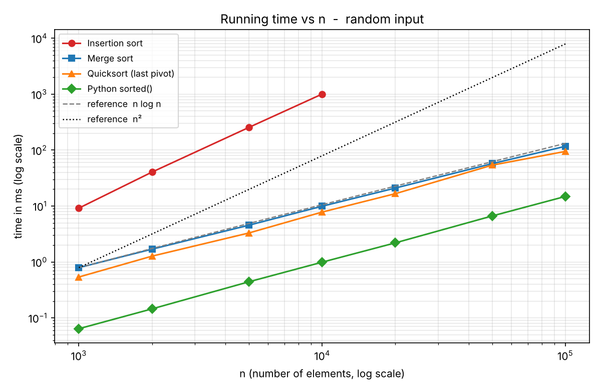
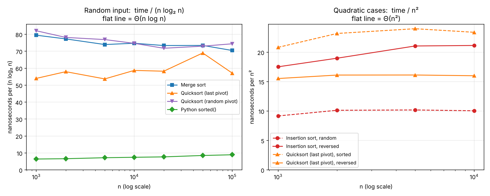
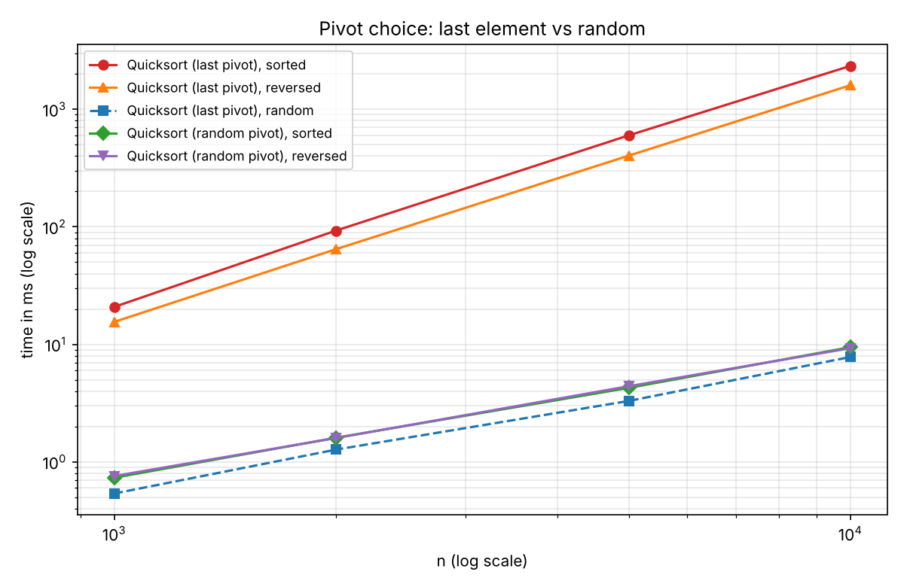

# Sorting Benchmark Lab: Report

**Course:** CS314 Analysis of Algorithms · Lecture 2 (Divide and Conquer) · **Level:** Beginner mini project
**Author:** [Your Name] · **ID:** [Your ID]

## 1. Problem

Which sorting algorithm should we use, and does the theory (recurrences and asymptotic bounds) predict what we
actually measure? I compare **insertion sort**, **merge sort**, **quicksort** (last-element pivot, as in the
lecture) and Python's built-in **`sorted()`** on three input types (**sorted**, **reversed**, **random**), for
n = 1,000 to 100,000. As a bonus, I add quicksort with a **random pivot** to study its worst case.

## 2. Method

* **Implementation.** All algorithms are in `src/sorting_algorithms.py`, written from the lecture's pseudocode
  (`MERGE-SORT(A,p,r)`, `MERGE(A,p,q,r)`, `PARTITION(A,p,r)`). Quicksort uses an explicit stack, because a
  recursive quicksort on sorted input nests n calls deep and crashes Python's recursion limit.
* **Correctness.** 10 unit tests (`tests/`) cover empty, one-element, duplicate, sorted and reversed arrays, 150
  random arrays per algorithm checked against `sorted()`, the lecture's trace and partition examples, and
  stability (merge sort is stable, this quicksort is not). The benchmark also re-checks every result.
* **Measurement.** `time.perf_counter()`, **median of up to 5 runs** on fresh copies; data are permutations of
  1..n with a fixed seed. Machine-independent trends matter, not the absolute milliseconds.
* **Cap on quadratic cases.** Insertion sort (reversed, random) and last-pivot quicksort (sorted, reversed) cost
  about n²/2 steps; n = 100,000 would need hours in pure Python, so these run only up to **n = 10,000**.
  Every other combination runs up to n = 100,000.

## 3. Complexity analysis (theory)

| Algorithm | Recurrence / idea | Best | Average | Worst | Extra space | Stable |
|---|---|---|---|---|---|---|
| Insertion | shift keys into a sorted prefix | Ω(n) | Θ(n²) | O(n²) | O(1) | yes |
| Merge | T(n) = 2T(n/2) + Θ(n) | Θ(n log n) | Θ(n log n) | Θ(n log n) | O(n) | yes |
| Quick (last pivot) | T(n) = 2T(n/2) + Θ(n) if balanced; T(n) = T(n−1) + Θ(n) if not | Θ(n log n) | Θ(n log n) | **Θ(n²)** (sorted/reversed) | O(log n) expected | no |
| Python `sorted()` | Timsort (merge-sort hybrid) | Θ(n) | O(n log n) | O(n log n) | O(n) | yes |

By the Master Theorem, T(n) = 2T(n/2) + n falls in case 2, giving Θ(n log n). A last-element pivot on sorted or
reversed data splits n into 0 and n−1 every time, so T(n) = T(n−1) + n = Θ(n²).

## 4. Experiments and results

Time in **milliseconds**, median of up to 5 runs.

**n = 10,000**

| Algorithm | Sorted | Reversed | Random |
|---|---:|---:|---:|
| Insertion sort | 0.50 | 2,114.3 | 1,004.8 |
| Merge sort | 7.91 | 7.65 | 9.93 |
| Quicksort (last pivot) | 2,338.2 | 1,600.2 | 7.80 |
| Quicksort (random pivot) *bonus* | 9.45 | 9.27 | 9.92 |
| Python `sorted()` | 0.03 | 0.04 | 0.99 |

**n = 100,000**

| Algorithm | Sorted | Reversed | Random |
|---|---:|---:|---:|
| Insertion sort | 5.34 | n/a (capped) | n/a (capped) |
| Merge sort | 94.4 | 91.2 | 117.0 |
| Quicksort (last pivot) | n/a (capped) | n/a (capped) | 94.8 |
| Quicksort (random pivot) *bonus* | 103.9 | 106.3 | 123.6 |
| Python `sorted()` | 0.58 | 1.17 | 14.8 |

**Fitted growth exponent k** (time ≈ c·nᵏ, log-log fit for n ≥ 2,000). A pure n log n algorithm fits k ≈ 1.1
at these sizes because the log factor adds a little slope; k ≈ 2 means quadratic.

| Algorithm | Sorted | Reversed | Random |
|---|---:|---:|---:|
| Insertion sort | 1.03 | 2.07 | 2.00 |
| Merge sort | 1.09 | 1.08 | 1.09 |
| Quicksort (last pivot) | 2.01 | 2.00 | 1.13 |
| Quicksort (random pivot) *bonus* | 1.07 | 1.07 | 1.09 |
| Python `sorted()` | 1.19 | 1.25 | 1.18 |

The flat lines show that time/(n log₂ n) is constant for merge sort, quicksort and `sorted()` on random data, and
that time/n² is constant for the quadratic cases.

## 5. Discussion

1. **The theory is confirmed.** Insertion sort is quadratic on reversed and random data (k ≈ 2.0–2.1) but linear
   on sorted data (k ≈ 1.0). Merge sort is Θ(n log n) on all three inputs and its time barely changes with the
   input type. Insertion sort on random data at n = 10,000 is about **100x slower** than merge sort.
2. **Quicksort's worst case is real.** With a last-element pivot, sorted input at n = 10,000 takes about
   **2,338 ms vs 7.8 ms on random data (about 300x)**, and its fitted exponent is 2.0. A **random pivot** removes the
   problem (9.5 ms on the same sorted input, about **250x faster**).
3. **Best algorithm depends on the data.** On random data quicksort (last pivot) is slightly faster than merge sort
   (about 1.2x at n = 100,000) because it works in place; on sorted data it is the *worst* of the four. Merge sort has
   no bad input, at the cost of O(n) extra memory.
4. **Insertion sort can win.** On already sorted input at n = 100,000 it takes about 5 ms, far less than merge sort
   (about 94 ms): O(n) beats O(n log n). This is why hybrid sorts use insertion sort on small or nearly sorted runs.
5. **`sorted()` is in a different league.** It is about **8x faster** than my merge sort on random data and almost
   instant on sorted or reversed data (Timsort detects existing runs), even though both are O(n log n): it is written
   in C and exploits pre-existing order. Constant factors matter in practice.

## 6. Conclusion

The measurements match the lecture's analysis: Θ(n²) for insertion sort on random/reversed data, Θ(n log n) for
merge sort and for quicksort on random data, and Θ(n²) for last-pivot quicksort on sorted/reversed data. In
practice, use the language's built-in sort; if writing your own, prefer merge sort or a randomized-pivot quicksort.
Limits: pure-Python timings, one machine, and the n ≤ 10,000 cap on quadratic cases.
