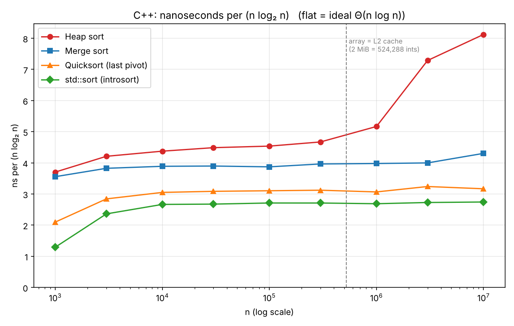

# Heap vs Quick vs Merge

**CS314 – Analysis of Algorithms · Lecture 3 (Heap Sort) · Mini project: *Heap vs Quick vs Merge* (Beginner)**
**Author:** [Your Name] · **ID:** [Your ID]

Benchmarks **heap sort** against **merge sort** and **quicksort** in Python (n up to 10⁶) and C++ (n up to 10⁷),
counts their key comparisons, and explains the gap, including the **cache behaviour** of heap sort.

📄 **Report: [REPORT.md](REPORT.md)** · 🎬 **Demo script: [docs/DEMO_SCRIPT.md](docs/DEMO_SCRIPT.md)** ·
💭 **Reflection: [docs/REFLECTION.md](docs/REFLECTION.md)**

## Highlights

* Heap sort does about **2.0x the comparisons of merge sort** (≈ 1.8 n log₂ n vs ≈ 0.93 n log₂ n).
* `BUILD-MAX-HEAP` costs only **≈ 1.88·n** comparisons: it is linear.
* In C++, heap sort is **1.5x slower than quicksort** while the array fits in cache, but **2.6x slower at n = 10⁷**.



## Project structure

```
heap-vs-quick-vs-merge/
├── src/
│   ├── heap.py                 # PARENT/LEFT/RIGHT, MAX-HEAPIFY, BUILD-MAX-HEAP, HEAPSORT, INSERT, EXTRACT-MAX
│   ├── sorting_algorithms.py   # merge sort, quicksort, sorted() (+ comparison counters)
│   ├── datasets.py             # input generators
│   ├── benchmark.py            # Python experiments: time, comparisons, BUILD-MAX-HEAP
│   ├── plot_cpp.py             # plots the C++ results
│   ├── demo.py                 # step-by-step trace of Q5, Q6, Q7 (for the demo)
│   └── env_info.py             # records the machine used
├── cpp/bench.cpp               # C++ benchmark (heap, merge, quick, std::sort)
├── tests/test_heap_and_sorting.py   # 17 unit tests
├── results/                    # CSVs, logs and figures used in the report
├── docs/DEMO_SCRIPT.md · docs/REFLECTION.md
├── REPORT.md · README.md · requirements.txt · LICENSE
```

## How to run

Requires Python 3.8+. A C++ compiler (`g++`) is needed only for the C++ part.

```bash
pip install -r requirements.txt

python -m unittest discover -s tests -v          # 17 unit tests
python src/demo.py                               # trace of the lecture's Q5, Q6, Q7

python src/benchmark.py --quick --out /tmp/quick # fast sanity run (about 10 s), does not touch results/
python src/benchmark.py                          # full Python run (about 2 minutes), writes results/

g++ -O2 -std=c++17 -o cpp/bench cpp/bench.cpp    # C++ part
./cpp/bench results/cpp_results.csv              # about 20 s (add --quick to stop at n = 10^6)
python src/plot_cpp.py results                   # draws the C++ figures
```

> Run the Python and C++ benchmarks **one after the other**, not at the same time, so they do not disturb each
> other's timings. Absolute times depend on the machine; the trends and the comparison counts do not.
> The machine used for the committed results is listed in [`results/environment.txt`](results/environment.txt).

## Results at a glance

**Python, random input (ms)**

| n | Heap sort | Merge sort | Quicksort | `sorted()` | Heap / Quick |
|---:|---:|---:|---:|---:|---:|
| 1,000 | 0.81 | 0.81 | 0.53 | 0.06 | 1.52x |
| 3,000 | 3.05 | 2.56 | 1.96 | 0.23 | 1.55x |
| 10,000 | 11.9 | 9.72 | 7.41 | 0.97 | 1.61x |
| 30,000 | 41.8 | 33.0 | 25.9 | 3.49 | 1.61x |
| 100,000 | 181.6 | 123.8 | 105.3 | 16.5 | 1.73x |
| 300,000 | 794.4 | 441.6 | 325.3 | 50.2 | 2.44x |
| 1,000,000 | 2,951.2 | 1,652.0 | 1,287.8 | 213.6 | 2.29x |

**C++ -O2, random input (ms)**

| n | Heap sort | Merge sort | Quicksort | `std::sort` | Heap / Quick |
|---:|---:|---:|---:|---:|---:|
| 1,000 | 0.04 | 0.04 | 0.02 | 0.01 | 1.77x |
| 3,000 | 0.15 | 0.13 | 0.10 | 0.08 | 1.48x |
| 10,000 | 0.58 | 0.52 | 0.41 | 0.35 | 1.43x |
| 30,000 | 2.00 | 1.74 | 1.38 | 1.19 | 1.45x |
| 100,000 | 7.54 | 6.43 | 5.16 | 4.50 | 1.46x |
| 300,000 | 25.5 | 21.6 | 17.0 | 14.8 | 1.50x |
| 1,000,000 | 103.0 | 79.3 | 61.1 | 53.6 | 1.69x |
| 3,000,000 | 470.3 | 258.1 | 209.1 | 176.0 | 2.25x |
| 10,000,000 | 1,888.6 | 1,000.8 | 736.5 | 637.8 | 2.56x |

Raw data: [`time_results.csv`](results/time_results.csv), [`comparisons.csv`](results/comparisons.csv),
[`build_heap.csv`](results/build_heap.csv), [`cpp_results.csv`](results/cpp_results.csv).

## Hand-in checklist (Lecture 3, "What to hand in")

| Item | Where |
|---|---|
| Code: clean repository, README, unit tests | `src/`, `cpp/`, `tests/`, this README |
| Report: problem, method, complexity analysis, experiments, conclusion | [REPORT.md](REPORT.md) |
| Demo: 5-minute walkthrough | [docs/DEMO_SCRIPT.md](docs/DEMO_SCRIPT.md) (+ `python src/demo.py`) |
| Reflection | [docs/REFLECTION.md](docs/REFLECTION.md) |

## References

* Lecture 3 – *Heap Sort*, CS314 Analysis of Algorithms (2026).
* Cormen, Leiserson, Rivest, Stein. *Introduction to Algorithms*, 4th ed., Ch. 6: heaps, heapsort, priority queues.
* Musser. *Introspective sorting and selection algorithms*. Software: Practice & Experience, 1997 (introsort).
