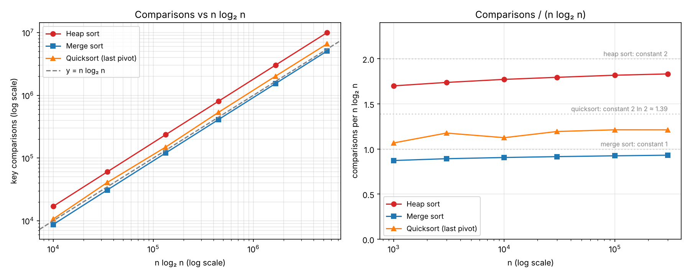
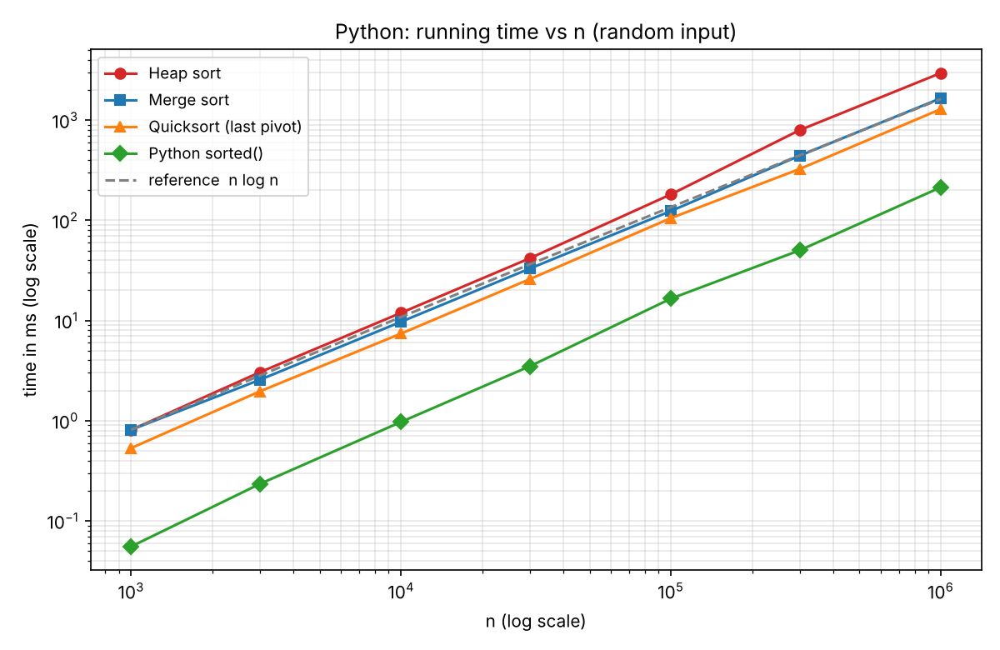
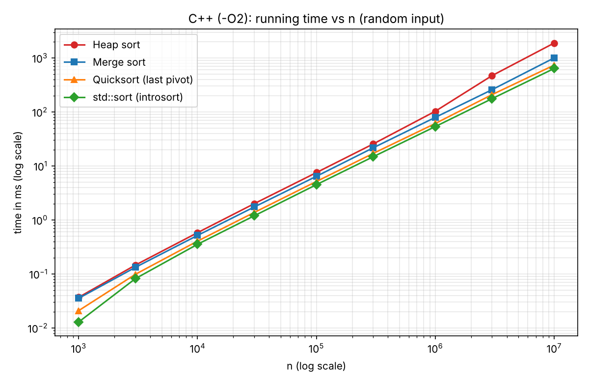
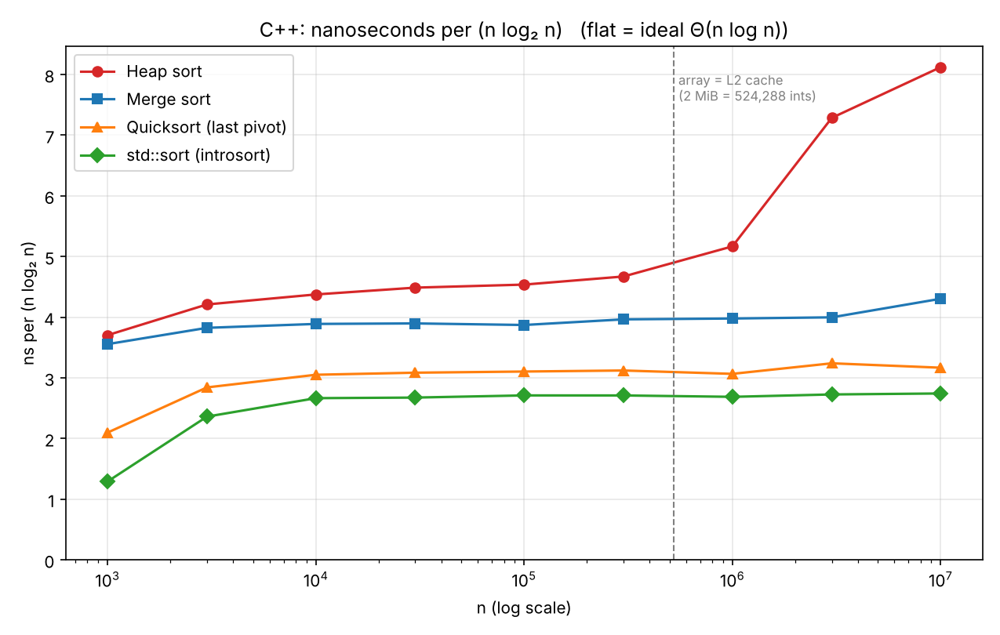

# Heap vs Quick vs Merge: Report

**Course:** CS314 Analysis of Algorithms · Lecture 3 (Heap Sort) · **Level:** Beginner mini project
**Author:** [Your Name] · **ID:** [Your ID]

## 1. Problem

Heap sort is the only one of our sorts that is both **guaranteed Θ(n log n)** and **in place** (O(1) extra space), yet
in practice it is slower than quicksort and often merge sort. **How big is the gap, and why?** I benchmark heap sort
against merge sort and quicksort (last-element pivot) in **Python** (n = 10³ … 10⁶), count their **key comparisons**,
and repeat the timing in **C++** (n = 10³ … 10⁷), where the CPU cache effects that the lecture mentions become visible.

## 2. Method

* **Implementation.** `src/heap.py`: `max_heapify` (iterative, so O(1) space), `build_max_heap`, `heap_sort`, plus
  `INSERT` / `EXTRACT-MAX`. `src/sorting_algorithms.py`: merge sort, quicksort (explicit stack) and `sorted()`.
  Every sort also has a *counted* version that returns its number of key comparisons. `cpp/bench.cpp` has the same
  three algorithms plus `std::sort` as a reference.
* **Correctness.** 17 unit tests: empty / one-element / duplicate / sorted / reversed arrays, 150 random arrays per
  algorithm checked against `sorted()`, the heap property after `BUILD-MAX-HEAP`, the **answer key of the lecture**
  (Q5 build, Q6 two HEAPSORT iterations, Q7 insert, task-scheduler order), and stability (heap sort is **not**
  stable, merge sort is). The C++ benchmark checks `is_sorted` on every algorithm and size.
* **Measurement.** Random permutations of 1..n (fixed seed). Python: `perf_counter`, median of up to 5 runs. C++:
  `steady_clock`, median of 15 / 7 / 3 runs (small / medium / large n), copy of the input made *outside* the timer.
* **Machine.** a shared cloud VM with one core: Intel Xeon @ 2.30 GHz, L1d cache 48 KiB, L2 cache 2 MiB (the L3 size reported by the hypervisor is not reliable, so I do not use it); Python 3.12, g++ 13.3 with `-O2`.

## 3. Complexity analysis (theory)

| Algorithm | Best | Average | Worst | Extra space | Stable | Expected key comparisons |
|---|---|---|---|---|---|---|
| Heap sort | Θ(n log n) | Θ(n log n) | Θ(n log n) | **O(1)** | no | ≈ 2 n log₂ n |
| Merge sort | Θ(n log n) | Θ(n log n) | Θ(n log n) | O(n) | yes | ≈ n log₂ n |
| Quicksort (last pivot) | Θ(n log n) | Θ(n log n) | Θ(n²) | O(log n) expected | no | ≈ 1.39 n log₂ n |

`MAX-HEAPIFY` costs O(h) for a node of height h. Because half of the nodes are leaves and only ⌈n/2^(h+1)⌉ nodes
have height h, `BUILD-MAX-HEAP` costs Σ ⌈n/2^(h+1)⌉·O(h) = **O(n)**. The sorting phase then does n−1 extractions of
O(log n) each, so heap sort is Θ(n log n). Each level of a sift-down needs **two** comparisons (child vs child, then
child vs parent); this is why heap sort does about twice as many comparisons as merge sort.

## 4. Results

### 4.1 Comparison counts (Python counters, n = 300,000)

| Algorithm | Comparisons | per n log₂ n | Theory (leading term) |
|---|---:|---:|---|
| Heap sort | 10,001,324 | 1.83 | ≈ 2 n log₂ n |
| Merge sort | 5,084,691 | 0.93 | ≈ n log₂ n − 1.25 n |
| Quicksort (last pivot) | 6,618,365 | 1.21 | ≈ 1.39 n log₂ n − 2.85 n |

The counts follow n log₂ n for all three. Heap sort does **2.0x more comparisons than merge sort and
1.5x more than quicksort**. (The measured ratios approach the leading constants slowly because every count
also has a negative term of order n.)

### 4.2 BUILD-MAX-HEAP is linear

`BUILD-MAX-HEAP` used **1.88·n** comparisons at n = 1,000,000 and between 1.87·n and
1.91·n for every size, always below the 2n bound, so it is O(n) as proved in the lecture.

### 4.3 Running time in Python (ms, random input)

| n | Heap sort | Merge sort | Quicksort | `sorted()` | Heap / Quick |
|---:|---:|---:|---:|---:|---:|
| 10,000 | 11.9 | 9.72 | 7.41 | 0.97 | 1.61x |
| 100,000 | 181.6 | 123.8 | 105.3 | 16.5 | 1.73x |
| 1,000,000 | 2,951.2 | 1,652.0 | 1,287.8 | 213.6 | 2.29x |

All three are Θ(n log n); heap sort is the slowest and the gap grows with n
(1.5x slower than quicksort at n = 10³, 2.3x at n = 10⁶).
The built-in `sorted()` is about 14x faster than my heap sort at n = 10⁶.

### 4.4 Running time in C++ (ms, random input)

| n | Heap sort | Merge sort | Quicksort | `std::sort` | Heap / Quick |
|---:|---:|---:|---:|---:|---:|
| 10,000 | 0.58 | 0.52 | 0.41 | 0.35 | 1.43x |
| 100,000 | 7.54 | 6.43 | 5.16 | 4.50 | 1.46x |
| 1,000,000 | 103.0 | 79.3 | 61.1 | 53.6 | 1.69x |
| 10,000,000 | 1,888.6 | 1,000.8 | 736.5 | 637.8 | 2.56x |

Normalizing by n log₂ n shows what the gap is made of (**nanoseconds per n log₂ n**, flat = ideal):

| n | Array size | Heap sort | Merge sort | Quicksort | `std::sort` |
|---:|---:|---:|---:|---:|---:|
| 10,000 | 0.04 MiB | 4.38 | 3.89 | 3.05 | 2.67 |
| 100,000 | 0.38 MiB | 4.54 | 3.87 | 3.10 | 2.71 |
| 1,000,000 | 3.81 MiB | 5.17 | 3.98 | 3.07 | 2.69 |
| 10,000,000 | 38 MiB | 8.12 | 4.30 | 3.17 | 2.74 |

## 5. Discussion: explaining the gaps

1. **While the array fits in cache, the gap is the comparison count.** For n ≤ 3·10⁵ (array ≤ 1.2 MiB, inside the
   2 MiB L2) heap sort is about **1.46x** slower than quicksort in C++, close to the
   **1.51x** ratio of their comparison counts. The extra work comes from the second comparison at every sift-down level.
2. **Beyond the cache, memory access dominates.** Heap sort's cost per n log₂ n grows from 4.4 to
   **8.1 ns (1.86x)**, while quicksort stays almost flat (3.05 → 3.17 ns, 1.04x)
   and merge sort rises only slightly (1.11x). At n = 10⁷ heap sort is **2.56x** slower than quicksort and
   1.9x slower than merge sort. The jump starts once the 4 MiB+ array no longer fits in L2.
3. **Why heap sort is cache-unfriendly.** A sift-down visits a[i], a[2i+1], a[4i+3], …: each step jumps to an index
   roughly twice as far away, so the deepest levels land on different cache lines (and pages) on every step and the
   hardware prefetcher cannot help. Quicksort's partition and merge sort's merge read the array **sequentially**, so every cache
   line fetched is fully used. This explanation is *consistent with* the measurements; I did not read hardware cache-miss
   counters, so it is an inference.
4. **Python hides part of this.** Python is about **29x slower** than C++ for heap sort at n = 10⁶, and interpreter overhead dominates.
   The heap/quick gap in Python (1.5x → 2.3x) also widens with n, but in Python
   I cannot separate cache effects from other costs (lists of pointers to int objects), which is why the C++ experiment is needed.
5. **When to use heap sort anyway.** It is the only one with a guaranteed O(n log n) worst case **and** O(1) space. That is
   why introsort (`std::sort`) starts as quicksort and falls back to heap sort only when the recursion gets too deep;
   `std::sort` was the fastest method here (1.15x faster than my quicksort at n = 10⁷).

## 6. Conclusion

Heap sort is asymptotically as good as merge sort, but needs about twice as many comparisons and, for large arrays,
suffers from poor memory locality: it was 1.5x slower than quicksort inside the cache and
2.6x slower at n = 10⁷. Use the library sort in practice; use heap sort when memory is tight and a
worst-case guarantee is needed (or as the safety net inside introsort); and use a heap whenever you need a priority queue.
**Limitations:** one shared VM (timings of a single point can be noisy, hence medians of repeated runs), random
permutations only, no hardware cache counters, and a plain (top-down sift-down) heap sort.
