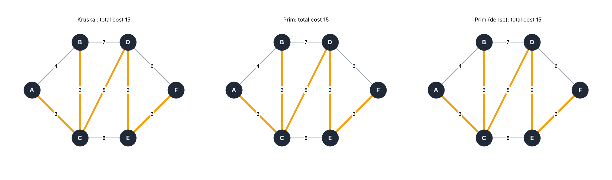

# Campus Network Planner: Kruskal, Prim and Dijkstra

Course project for **Analysis of Algorithms (CS314)**, Lecture 5: Greedy Algorithms.
The campus from the lecture (6 buildings, 9 possible cables) is modelled as a
weighted graph. The program answers two questions with greedy algorithms:

1. **What is the cheapest way to wire every building?** Minimum spanning tree with
   **Kruskal** (union-find), **Prim** (heap) and **Prim** (dense, O(V²)).
2. **What is the cheapest route from the Server Room to every building?**
   **Dijkstra** (heap).

Extension: **clustering** the buildings into *k* groups by stopping Kruskal early.



All results match the lecture: MST cost **15**, shortest distance to the Library
**13** (A → C → D → E → F), and the same step-by-step tables as the slides.
Everything is checked by 47 automated tests.

## Quick start

Python 3.10+. The algorithms use only the standard library; `pip` is needed only
for pictures and experiments.

```bash
git clone <your-repo-url>
cd campus-network-planner
python -m venv .venv && source .venv/bin/activate     # Windows: .venv\Scripts\activate
pip install -r requirements.txt

python main.py mst data/campus.txt --trace            # Kruskal + Prim, every decision
python main.py paths data/campus.txt A --trace        # Dijkstra table from the Server Room
python main.py paths data/campus.txt A --to F         # one route
python main.py cluster data/campus.txt 2              # 2 groups of buildings
python main.py mst data/campus.txt --png results/mst.png --gif results/kruskal.gif
python main.py generate 50 100 --seed 1 --out data/random50.txt
```

## Example output

```
$ python main.py mst data/campus.txt --algo kruskal --trace
Kruskal:
  Cable   Cost  Decision
  B-C     2     take
  D-E     2     take
  A-C     3     take
  E-F     3     take
  A-B     4     skip: cycle
  C-D     5     take
  cables : B-C(2), D-E(2), A-C(3), E-F(3), C-D(5)
  total  : 2 + 2 + 3 + 3 + 5 = 15
  check  : 5 cables = V - 1 = 5, no cycle

$ python main.py paths data/campus.txt A --trace
  Pick  A     B     C     D     E     F
  start 0     inf   inf   inf   inf   inf
  A     0     4     3     inf   inf   inf
  C     0     4     3     8     11    inf
  B     0     4     3     8     11    inf
  D     0     4     3     8     10    14
  E     0     4     3     8     10    13
  F     0     4     3     8     10    13
  F (Library): distance 13   path A -> C -> D -> E -> F
```

`results/campus_kruskal.gif` animates the Kruskal decisions (green = take,
red dashed = skip) and `results/campus_dijkstra.png` shows the shortest-path tree.

## Input format

```
node A Server Room     # a building (label optional)
pos  A 0 1             # optional x y, only for drawing (circular layout if missing)
edge A B 4             # a possible cable and its cost
```

Errors are reported with the line number. Duplicate cables, self-loops, unknown
keywords and empty files are rejected. A **negative** cost is accepted for the
MST (Kruskal and Prim still work) but **Dijkstra refuses it** with a clear message.
A **disconnected** graph gives a warning: Kruskal returns a minimum spanning
forest and Prim only covers the start building's component.

## Project layout

```
main.py                         command line interface
campusnet/
  graph.py                      Graph, Edge, text parser
  unionfind.py                  union-find (path compression + union by rank)
  mst.py                        kruskal(), prim(), prim_dense(), clusters()
  shortest.py                   dijkstra(), bellman_ford() (test oracle)
  generator.py                  random connected graphs
  visualize.py                  PNG pictures and Kruskal GIF
tests/                          47 unit tests (unittest)
experiments/run_experiments.py  timing experiments
data/                           campus.txt (lecture), disconnected.txt, negative.txt
results/                        figures, CSV data, summary.md
REPORT.md                       two-page report
REFLECTION.md                   what I learned and next steps
```

## Tests and experiments

```bash
python -m unittest discover -s tests -t . -v
python experiments/run_experiments.py
```

The tests include: every number from the lecture slides; MST cost compared with a
**brute-force search over all spanning trees** on 40 random graphs (with many
ties); Kruskal = Prim = dense Prim on 30 larger random graphs; the cut property
checked directly; Dijkstra compared with **Bellman-Ford** on 80 runs; disconnected
graphs, single building, zero and float costs, and bad input.

## Design decisions

* **Deterministic ties.** Cables are sorted by (cost, names), so runs are
  reproducible and match the slides (B-C before D-E when both cost 2).
* **Union-find** with path compression and union by rank (iterative, safe for
  50,000 chained buildings).
* **Lazy deletion in the heaps.** Python's `heapq` has no decrease-key, so stale
  entries are skipped when popped. The bound stays O(E log V).
* **Tracing is opt-in.** Recording the tree or distance table at each step costs
  O(V) per step and would make Prim and Dijkstra O(V²), so it is only on with
  `--trace`. (I found this by measuring: see REFLECTION.md.)
* **Fail loudly.** Negative costs for Dijkstra raise an error instead of
  returning a wrong answer.
