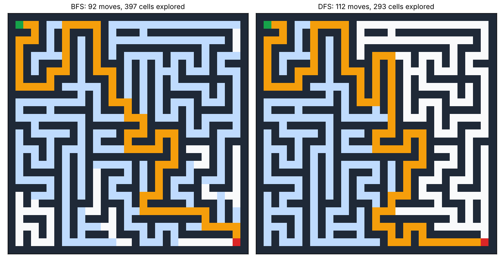

# Maze Solver: BFS vs DFS (+ Dijkstra)

Course project for **Analysis of Algorithms (CS314)**, Lecture 4: Graphs.
A grid maze is treated as an **implicit graph**. The program solves it with
**BFS** (queue, shortest path), **DFS** (stack, any path) and, as the extension,
**Dijkstra** (cheapest path through "mud" cells), then draws and compares them.

| Beginner project | Graph idea | Extension done |
|---|---|---|
| Maze Solver | Grid as an implicit graph, BFS vs DFS | Weighted cells + Dijkstra |



Green = start, red = end, blue = explored cells, orange = returned path.
BFS found 92 moves and explored 397 cells; DFS found a 112-move path and
explored 293 cells.

## Quick start

```bash
git clone <your-repo-url>
cd maze-solver
python -m venv .venv && source .venv/bin/activate     # Windows: .venv\Scripts\activate
pip install -r requirements.txt     # only needed for pictures / animations / experiments

python main.py solve mazes/lecture_example.txt --show
python main.py solve mazes/loops.txt --png results/loops_example.png
python main.py solve mazes/mud.txt --algos bfs dfs dijkstra
python main.py generate 41 41 --loops 0.05 --seed 1 --out mazes/m41.txt
python main.py solve mazes/m41.txt --png results/m41.png --gif results/m41_bfs.gif
```

The solvers themselves use only the Python standard library (Python 3.10+).

## Maze file format

```
S..#      #  wall        .  open cell
##..      S  start       E  end
...E      2-9  mud cell with that movement cost (Dijkstra only)
```

Expected for the lecture example: shortest path = **5 moves**.

## Example output

```
$ python main.py solve mazes/mud.txt --algos bfs dfs dijkstra
Maze 9x10, |V|=36, |E|=36
BFS       moves=13    cost=45    explored=26
DFS       moves=13    cost=45    explored=14
Dijkstra  moves=15    cost=15    explored=26
```

BFS minimises the **number of moves**, Dijkstra minimises the **cost**. On the
mud maze Dijkstra takes 2 more moves but pays 15 instead of 45.

## Project layout

```
main.py                      command line interface (solve / generate)
mazesolver/
  maze.py                    Maze class, parser, neighbors, |V| and |E|
  solvers.py                 bfs(), dfs(), dijkstra(), parent pointers
  generator.py               random maze generator (perfect + loops)
  visualize.py               PNG pictures and GIF animation
tests/                       29 unit tests (unittest)
experiments/run_experiments.py   timing and comparison experiments
mazes/                       example mazes
results/                     figures, CSV data, animations
REPORT.md                    two-page report
REFLECTION.md                what I learned and next steps
```

## Run the tests and experiments

```bash
python -m unittest discover -s tests -t . -v      # 29 tests
python experiments/run_experiments.py              # writes results/*
```

## Design decisions

* **Implicit graph.** Neighbors are computed on demand from the grid, so no
  adjacency list is stored. Memory is O(V) for the visited/parent data only.
* **Parent pointers, not stored paths.** Each solver keeps `parent[cell]` and
  rebuilds the path once at the end (the lecture's tip).
* **Iterative DFS.** An explicit stack avoids Python's recursion limit
  (tested on a 401×401 maze).
* **Fixed neighbor order** up, down, left, right, so every run is reproducible.
* **BFS marks a cell when pushed; DFS marks it when popped.** This keeps BFS
  from queueing a cell twice and keeps DFS a true "deep first" search.

## Animations

`results/demo31_bfs.gif` and `results/demo31_dfs.gif` show how each algorithm
explores the same 31×31 maze.
