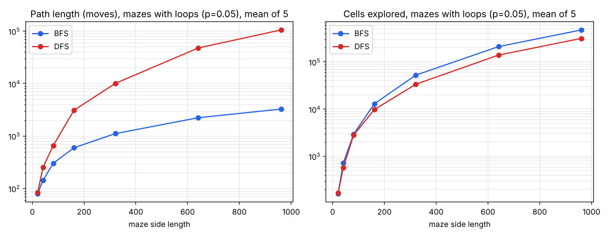

# Maze Solver: BFS vs DFS on a Grid Graph

**Course:** Analysis of Algorithms (CS314), Lecture 4: Graphs
**Project:** Maze Solver (beginner) with the Dijkstra extension

## 1. Problem

Given a rectangular maze with walls, one start cell `S` and one end cell `E`,
find a route from `S` to `E` moving up, down, left or right. The project
compares two ways to search: BFS (which guarantees the fewest moves) and DFS
(which finds some path, going as deep as possible first). As an extension, cells
can have a movement cost ("mud", digits 2-9) and Dijkstra finds the cheapest route.

## 2. Graph model

The maze is an **undirected, unweighted graph** (weighted for the extension):

* **Vertex:** every open cell `(row, col)`. |V| = number of open cells.
* **Edge:** two open cells that are neighbors in the four directions. |E| is
  the number of such adjacent pairs.
* **Implicit graph:** the adjacency list is never built. `neighbors(cell)` tests
  the four directions on demand, so no extra memory is used for edges.

Because every vertex has degree at most 4, |E| ≤ 2|V|, so |V|+|E| = Θ(|V|).
For the 3×4 example in the lecture, |V| = 9 and |E| = 9.

## 3. Algorithms and complexity

**BFS** keeps a queue and a `parent` map (the π of the lecture). A cell is
marked when it is pushed, so it enters the queue once. Cells leave the queue in
order of distance from `S`, so the first time `E` is reached the path found
through `parent` has the fewest moves. *Time O(V+E), space O(V).*

**DFS** keeps an explicit stack. A cell is marked when it is popped, together
with the cell it came from. It follows one branch to the end before
backtracking. The path is valid but not necessarily shortest. *Time O(V+E),
space O(V).* The explicit stack avoids Python's recursion limit.

**Dijkstra** (extension) uses a binary heap and relaxes `dist[v]`. It returns
the cheapest path for costs 1-9. *Time O((V+E) log V), space O(V).* With all
costs equal to 1 it returns a path as short as BFS.

All three rebuild the path once from `parent`, so no path is copied inside the
queue or stack. Early exit: each solver stops as soon as `E` is expanded, so the
**worst case** O(V+E) happens when `E` is unreachable or found last.

**Correctness checks.** 29 unit tests, including: BFS path length compared with
an independent relaxation oracle on 15 random mazes; every returned path is
checked step by step (starts at `S`, ends at `E`, every step is a real
neighbor); unreachable `E`; invalid files; and a 401×401 maze for recursion safety.

## 4. Experiments

Mazes come from a seeded generator. A *perfect* maze (no loops) has exactly one
path, so BFS and DFS must return the same one. *Loop* mazes (extra walls removed
with probability p = 0.05) have several routes. Sizes: 21² up to 961² cells
(|V|+|E| up to about 9.6×10⁵), 5 random mazes per size, timing = best of 3 runs.

### 4.1 Running time is linear

For loop mazes, a straight line fits time against |V|+|E| with R² = 0.995 (BFS)
and 0.984 (DFS). This matches O(V+E). In perfect mazes BFS has a lower R²
(0.834) because it stops when it reaches `E`, so the work depends on where
`E` lies relative to the BFS frontier, and the whole graph is not always
visited. Plotting time against the number of cells actually *explored*
(`results/time_vs_explored.png`) gives R² = 0.994 (BFS) and 0.992 (DFS) with
about 1.7-1.9 µs per cell on my machine: time is proportional to the work done.
(Absolute times depend on the computer; the linear shape does not.)

### 4.2 BFS vs DFS on mazes with loops (mean of 5)

| Side | BFS moves | DFS moves | BFS explored | DFS explored |
|---:|---:|---:|---:|---:|
| 21 | 81 | 85 | 163 | 168 |
| 81 | 306 | 666 | 2,950 | 2,830 |
| 161 | 603 | 3,114 | 12,957 | 9,782 |
| 321 | 1,120 | 10,125 | 52,212 | 33,486 |
| 961 | 3,280 | 105,134 | 472,044 | 312,298 |

* BFS path length grows roughly linearly with the side (3,280 at 961), as a
  shortest path should.
* The DFS path is **32 times longer** at side 961 (105,134 moves): it wanders
  through large parts of the maze before reaching `E`.
* DFS explored about **34% fewer** cells at side 961 and 25% fewer at side 161.
  It is cheaper to run, but the answer is much worse. At side 21 it explored
  slightly *more* cells, so this is a trend and not a rule.
* In perfect mazes both return the same path (verified by a test).

### 4.3 Weighted cells

On `mazes/mud.txt`, BFS returns 13 moves but they cross the mud: cost 45.
Dijkstra takes 15 moves for cost 15 (`results/mud_bfs_vs_dijkstra.png`). BFS is
optimal for *moves*, not for *cost*.

## 5. Conclusion

Treating the grid as an implicit graph makes BFS and DFS short to write and
O(V+E) in time and O(V) in memory. Measured times grow linearly with |V|+|E|
as the analysis predicts. Use **BFS** when the shortest route matters; DFS gives
a valid but possibly very long route; once cells have different costs, use
**Dijkstra**. Limits: only 4 directions, times measured in Python on one
machine, and only 5 mazes per size (so means are indicative, not exact).

*Reproduce:* `python experiments/run_experiments.py` (data in `results/experiments.csv`).
